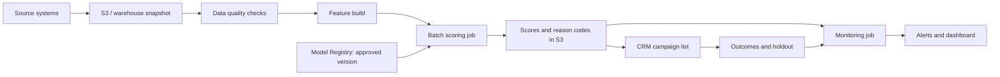
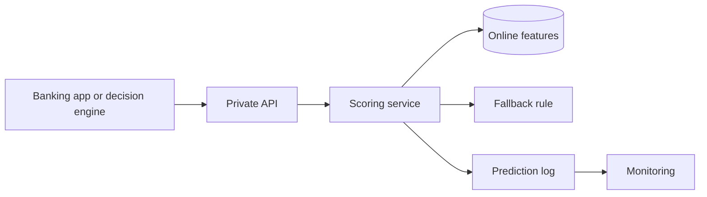
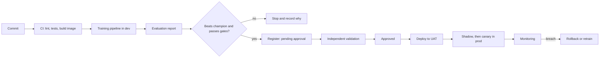

# Chapter 59 — ML Engineer at a UAE Bank: Build-and-Ship Interview Notes

> **What this is.** Notes for a hands-on Machine Learning Engineer contract at a large UAE bank: propensity,
> churn, segmentation, forecasting, recommendation and risk models, built in Python and shipped on AWS, inside a
> regulated bank.
>
> **Format of the interview.** One or two rounds on Microsoft Teams or in person. The second round depends on the
> first. They assess six things: hands-on ML problem solving, Python and SQL, evaluation and explainability,
> productionisation, AWS deployment, and how clearly you talk to business people.
>
> **How this chapter was checked.** Every Python block and SQL query here was run before commit (Python 3.11,
> scikit-learn 1.9, XGBoost 3.2, pandas 3.1, DuckDB 2.0, MLflow 3.18). Every model number in Section 4 was measured
> on a real public bank dataset. Worked business examples use made-up round numbers and say so. Regulatory and AWS
> facts were checked on 6 Nov 2026, the whole chapter had an independent accuracy review, and Section 16 lists the sources.
>
> **Pairs with:** [Ch.47](47_production_ml_aws_technical_round.md) (production operations),
> [Ch.14](14_monitoring_drift.md) (drift), [Ch.29](29_ensemble_models.md) (boosting),
> [Ch.38](38_lambda_cold_start_ml.md) (Lambda), [Ch.57](57_three_system_designs_simple.md) (how to open a design
> answer). Ch.47's Model Monitor advice is now out of date; Section 8.6 corrects it.

---

## Contents

0. [The role in one minute](#0-the-role-in-one-minute)
1. [JD line to evidence map](#1-jd-line-to-evidence-map)
2. [Your opening and your one story](#2-your-opening-and-your-one-story)
3. [The six banking use cases](#3-the-six-banking-use-cases)
4. [Evaluation, using a real bank dataset](#4-evaluation-using-a-real-bank-dataset)
5. [Explainability and SHAP](#5-explainability-and-shap)
6. [Python drills](#6-python-drills)
7. [SQL drills](#7-sql-drills)
8. [Production on AWS](#8-production-on-aws)
9. [Monitoring and retraining](#9-monitoring-and-retraining)
10. [Governance in a UAE bank](#10-governance-in-a-uae-bank)
11. [Dataiku and MLflow in one page each](#11-dataiku-and-mlflow-in-one-page-each)
12. [Talking to business stakeholders](#12-talking-to-business-stakeholders)
13. [One full worked case](#13-one-full-worked-case-card-attrition)
14. [Question bank](#14-question-bank)
15. [Questions to ask, study plan, cheat sheet](#15-questions-to-ask-study-plan-cheat-sheet)
16. [Sources](#16-sources)

---

## 0. The role in one minute

This is a **build-and-ship role, not a platform role.** You own a use case from start to finish: frame it with the
business, build and validate the model, put it in production, and keep it healthy. The weight sits on hands-on ML
and production Python. AWS is how you ship, not the point of the job.

Three things make it different from a product-company ML job:

1. **Governance is part of the work.** Your model has to survive an independent Model Validation team. Documentation
   is a deliverable, not an afterthought.
2. **It is a 12-month contract.** They want someone who ships fast and leaves things behind that the internal team can
   run. Expect "what would you do in your first 90 days?" and "how do you hand over?"
3. **It is a UAE bank on AWS in 2026.** Where the workloads run is a live question. See Section 8.1 before the
   interview.

**Where to spend your prep time:**

| What they score | Read | Share of prep | Likely weak spot |
|---|---|---|---|
| Hands-on ML problem solving | §3, §13 | 25% | Churn and segmentation (no production project) |
| Python and SQL | §6, §7 | 25% | Speed under pressure, not knowledge |
| Evaluation and explainability | §4, §5 | 20% | Calibration, SHAP limits |
| Productionisation | §8, §9 | 10% | Low risk, this is your strength |
| AWS deployment | §8 | 10% | Step Functions, ECS/EKS |
| Talking to business | §2, §12 | 10% | Saying it in money, not AUC |

---

## 1. JD line to evidence map

Be exact about which column you are in. A bank panel will check.

### Strong: say it plainly

| JD asks for | Your evidence |
|---|---|
| End-to-end models in production | Loan-withdrawal XGBoost model at TrueBalance, live as an SQS-triggered Lambda container. NatWest end-to-end ML system on SageMaker. |
| Banking or regulated industry | NatWest (UK bank, via Tiger Analytics), TrueBalance (digital lender), loan-risk model at Sopra Steria, HIPAA-class data at ResMed. |
| Python, pandas, scikit-learn, XGBoost, LightGBM | Daily tools. |
| SQL on large datasets | Athena, Snowflake. |
| Packaging, containers, batch and real-time | ECR containers as SageMaker pipeline steps at NatWest. Lambda containers at TrueBalance. Multi-container and async endpoints at ResMed. |
| AWS: SageMaker, S3, ECR, Lambda, CloudWatch | All used in production. |
| Git, code review, CI/CD | Jenkins, GitHub Actions, promotion from test to production. |
| Drift and monitoring | NatWest drift checks with retraining triggers. Python utility at ResMed that turns data scientists' drift rules into Datadog dashboards and alerts. |
| Reproducibility | Found and fixed order-dependent feature code so the same input always gives the same output. |

### Bridge: real but adjacent, so name the distance

| JD asks for | What you can honestly say |
|---|---|
| Propensity | The withdrawal model **is** a propensity model: will this customer take this offer? Say that out loud. |
| Risk | A default-prediction study handed to Decision Science, and an early loan-risk ensemble. Not a live credit-decision model. |
| Forecasting | Time-series anomaly detection on server metrics at Sopra Steria. Not business forecasting. |
| Recommendation | You helped run and harden a production recommender. You did not build the model. Keep that line clear. |
| Explainability | The XAI layer on the loan-risk model. Confirm the exact method before you name it. |
| Kubernetes | Used through a platform at ResMed. You have not operated a cluster. |
| Terraform | On your resume. Rehearse what you actually wrote before you claim depth. |
| Model governance | Regulated delivery, CI gates, PII masking, human review. Be precise about whether you personally sat through a formal validation. |

### Gap: say so before they find out

| JD asks for | Status | Bridge |
|---|---|---|
| Churn, segmentation | No production project | Same shape as propensity. Reason from first principles (§3). |
| MLflow | Not on your master resume. Treat as a gap | Run the drill in §11, then say "practice project" and nothing more. |
| Dataiku | Not used | Nice-to-have only. §11 maps it to what you know. |
| Step Functions | Not used | SageMaker Pipelines and Airflow solve the same problem (§8.4). |
| ECS, EKS | Not used directly | Lambda and SageMaker. Know when you would pick ECS (§8.3). |

**The gap script.** Use this shape every time:

> "I haven't used X in production. What I've used is Y, which solves the same problem. The main difference I'd expect
> is Z. I'd want a few days with your setup before I was useful on it."

A clean gap answer scores better than a shaky claim. These are hands-on engineers, and one follow-up exposes a bluff.

---

## 2. Your opening and your one story

### The 60-second opening

Use this one, not the older versions elsewhere in this repo. Those contain claims that have since been tightened.

> "I'm Sachin, a machine learning engineer with eight years of taking models into production, mostly for banks and
> lenders. At Tiger Analytics I built NatWest's end-to-end ML system on AWS SageMaker: data preparation, training,
> batch inference, drift checks and CI/CD. At ResMed I worked on regulated healthcare data, adding multi-container
> SageMaker endpoints and building a utility that turned data scientists' drift rules into Datadog dashboards and
> alerts. Now at TrueBalance, a digital lender, I ship loan models. The work I enjoy most is what this role describes:
> owning a use case from the business question to a model that is still healthy six months later, with documentation
> a validator can rely on."

### The story they asked for

The application itself asks for one model taken from prototype to production: **the problem, the stack, and what
happened after go-live.** Expect the first round to start here. Have it ready in 30 seconds, 2 minutes and 5 minutes.

```
PROBLEM      Predict, for each loan offer, whether the customer will draw it.
PROTOTYPE    Strong offline score on thousands of features.
THE CATCH    The serving path only had a small fraction of those features.
             On those, the model was close to random.
DECISION     Did not ship it. Rebuilt it at offer level, so serving computes
             the full feature set from the same source as training.
STACK        XGBoost native booster. SQS trigger, Lambda container from ECR.
             Encrypted input read from S3. Jenkins promotion dev to stage.
AFTER        Runs at high volume. Fixed a CI bug where a containerised Jenkins
             mounted an empty directory. Then: your real business outcome.
```

**The 2-minute version:**

> "The clearest one is a loan-withdrawal model at a digital lender. The question was: for each offer, will this customer
> actually draw the loan? The first version looked great offline, with a strong out-of-time ROC-AUC on thousands of
> features. Before shipping, I compared what training used with what the live path could actually supply, and the live
> path had only a small fraction of those features. Scored on those, the model was close to random. So we did not ship
> it. The offline number was real, but it described a model that could not exist in production.
>
> I rebuilt it at offer level. Each SQS message carries the offer and a pointer to the customer's encrypted report in S3.
> A Lambda container decrypts it, computes the same features as training, scores a native XGBoost booster, and returns
> the probability, the decision, the threshold and the offer ID. After go-live the work was operational: promotion had a
> bug where Jenkins, running in a container, mounted an empty directory, so I baked the files into the runner images.
> [Say your real business outcome here, in one sentence.]
>
> The lesson I take into every project: before you trust an offline score, prove the serving path can reproduce those
> exact features."

**Push questions to rehearse:**

| They ask | Short answer |
|---|---|
| "How did you find the gap?" | Compared the training feature list with what the serving payload actually contained, then re-scored on the serving subset. |
| "Why Lambda, not an endpoint?" | Event-driven, spiky load, one message per offer, no always-on instances to pay for. Cold start was acceptable for an asynchronous flow. |
| "What about monitoring?" | Be exact about what exists today. Then say what you would add: score distribution, feature null rates, and outcome tracking once labels mature. |
| "What was the business impact?" | Only a number you can defend. If you do not have one, say what was measured and what was not. |

> **Do not improvise this answer.** "What happened after go-live" is the weakest part of the story right now. Write one
> true sentence about outcome before you send anything.

### Backup stories

| If they ask about | Tell | The point |
|---|---|---|
| Regulated delivery | NatWest: contact-reason classifier on customer chats, batch inference, CI/CD with unit tests, promotion from test to production, retraining triggered by monitoring | You know how a bank ships |
| Robust validation | Default-prediction study: label shuffle, removing suspect features, out-of-time test, all before anyone trusted the AUC | You try to break your own result |
| Reproducibility | Feature code gave different values on identical input because of unstable sort ties. Fixed with deterministic keys and a regression test that fails without the fix | "Same input, same output" is testable |
| Enabling others | ResMed Datadog utility | You scale data scientists, not just models |
| Saying no | The withdrawal model you did not ship | Judgement beats a good metric |

---

## 3. The six banking use cases

### Two rules for all of them

**Rule 1: the prediction must change a decision.** Before any modelling, ask: "If I give you this score tomorrow, what
will you do differently, and who does it?" If there is no answer, there is no project.

**Rule 2: draw the timeline first.** Most bank ML bugs are timeline bugs.

```
            feature window            gap        outcome window
   |------------ 90-365d ------------|-30d-|---------- 60-90d --------|
                                     ^
                               snapshot date T

   Features  use only what was known at T.
   Gap       gives the campaign team time to act. Events here do not count.
   Outcome   defines the label.
```

Then repeat it for many snapshot dates. One customer appears many times, so splits must respect both customer and time.

### 3.1 Propensity (who will take this product?)

| Item | Detail |
|---|---|
| Label | Took the product within N days of the offer or snapshot |
| Population | Customers **eligible** for the product and allowed to be contacted |
| Metrics | Lift in top deciles, PR-AUC, calibration if scores feed an expected-value rule |
| Action | CRM campaign list, ranked, under a contact cap |
| Biggest trap | **Selection bias.** You only see responses from people the bank chose to contact |

**Propensity is not persuasion.** A high score can mean "would have bought anyway". The real question is uplift:

```
                    Buys if NOT contacted
                       No            Yes
   Buys if     Yes  PERSUADABLES   SURE THINGS     <- spend here / wasted spend
   contacted   No   LOST CAUSES    SLEEPING DOGS   <- ignore / contact hurts you
```

**Say this:** "Propensity ranks who is likely to convert. To know whether the campaign caused it, I need a random
holdout. I'd insist on one from the first campaign, because without it nobody can prove the model made money."

Uplift methods exist (such as a two-model T-learner, scored with a Qini curve), but start with a holdout. It is cheap and it settles arguments.

### 3.2 Churn (who is leaving?)

Retail banking has no cancellation event for most customers. People just stop using the account. **You have to define
churn, and that definition is the most important modelling decision.**

| Candidate definition | Trade-off |
|---|---|
| Account closed | Clean, but too late to act |
| Salary credit stopped | Strong signal for salaried customers, misses others |
| Card inactive for 90 days after being active | Good for card attrition |
| Balance and activity below a threshold | Flexible, needs business sign-off |

- **Population:** customers active at T, so you predict leaving, not "already gone".
- **Gap window:** essential. Nobody can save a customer who churns tomorrow.
- **UAE angle (a hypothesis, test it):** a large expat base means some churn is someone leaving the country. That may not
  be saveable, so check whether retention should treat it differently.
- **Leak fields:** closure requests, retention-team flags, complaint outcomes, anything refreshed after T.
- **Alternative:** survival models handle customers whose outcome is still unknown, and they answer *when*, not just
  *whether*. Worth naming, but a well-framed classifier usually ships first.

**You have no production churn project.** Say: "Not in production, but the withdrawal model has the same shape: a binary
outcome, a time window and an action. The new work is the label, so I'd start by agreeing the definition with the
business."

### 3.3 Segmentation (what groups exist?)

Unsupervised, so there is no label to score against. "Good" means **stable, distinct and actionable.**

1. Build behaviour features: recency, frequency, monetary value, product mix, channel use.
2. Log-transform money columns, because they are heavily skewed. Then scale.
3. Cluster. K-means is the default. K-prototypes handles mixed types. Gaussian mixtures give soft membership.
4. Pick k with silhouette and elbow, then check with the business. Six segments nobody can act on is worse than four.
5. Test stability by reclustering on bootstrap samples and comparing assignments with adjusted Rand index.
6. Profile and name the segments with the business.
7. In production, assign new customers to frozen centroids so segment labels do not reshuffle every month.

**Traps:** a few high-net-worth customers can dominate K-means. Unscaled money columns will define the clusters by
themselves. Using nationality as a clustering feature creates a fairness problem. Segments drift, so monitor their sizes.

### 3.4 Forecasting (deposits, cash, call volumes, delinquency)

- **Always beat a baseline first.** Seasonal naive means "same as this period last year or last week". If you cannot beat
  it, stop and find out why.
- **Backtest with rolling origin**, never a random split.
- **Metrics:** WAPE for business reporting, MASE to compare against naive across series. MAPE breaks near zero.
- **Give a range, not a number.** Quantile forecasts let treasury or operations plan for the bad case.

**UAE calendar traps that show real domain sense:**

| Trap | Why it bites |
|---|---|
| **Ramadan and Eid move** | The Islamic year is about 11 days shorter, so these fall about 11 days earlier each Gregorian year. A plain "same month last year" feature misaligns them. Build days-to-Eid features from the Hijri calendar. |
| **Weekend change** | In January 2022 the federal government moved to a Saturday-Sunday weekend with a Friday half-day, and Sharjah chose Friday to Sunday. Banks were told to stay open six days a week. So history across that date can have a break in day-of-week patterns, and it differs by series. Check the calendar that applies. |
| **Salary dates** | Month-end salary cycles dominate deposit and spend patterns. |
| **2026 regional disruption** | Behaviour during 2026 may not reflect normal conditions. Do not silently drop or keep those months. Flag them, test both ways, and record the decision. |

### 3.5 Recommendation (next best offer)

A bank has tens of products, not millions of items. So do not reach for a two-tower deep model.

```
 rank = P(takes product) x value of product, then apply business rules

   1. One calibrated propensity model per product
   2. Multiply by expected value
   3. Remove ineligible products and blocked customers
   4. Apply contact caps and cool-down periods
   5. Keep a random holdout to measure real lift
```

Calibration matters here because you compare scores **across** models. A card score of 0.4 and a loan score of 0.3 only
mean something if both are real probabilities.

Offline, use hit rate at k, NDCG at k and coverage. Collaborative filtering earns its place when the catalogue is large,
such as merchant offers. **Your line:** you helped operate a production recommender, and you did not build its model.

### 3.6 Risk (first ask which kind)

"Risk" could mean credit, fraud, AML or collections. Ask. Vocabulary you should have ready:

| Term | Meaning |
|---|---|
| PD, LGD, EAD | Probability of default, loss given default, exposure at default |
| ECL | Expected credit loss. PD x LGD x EAD is the one-period shorthand. IFRS 9 ECL is probability-weighted, forward-looking and discounted |
| IFRS 9 stages | 1: performing, 12-month ECL. 2: significant increase in credit risk, lifetime ECL. 3: credit-impaired, lifetime ECL, interest on the net carrying amount |
| Gini | 2 x AUC - 1. Risk teams often quote this instead of AUC |
| KS | Largest gap between the cumulative distributions of goods and bads |
| DPD | Days past due. A label might be "90+ DPD within 12 months" |
| Vintage analysis | Default curves by origination cohort |
| Reject inference | You only observe outcomes for approved applicants, so this estimates how rejected applicants would have behaved |
| Scorecard, WoE | Logistic regression on binned features. Still common because it is easy to explain |

**Traps:** you only see outcomes for people you approved. Monotonic behaviour is often required, since more arrears should
never lower risk (XGBoost supports `monotone_constraints`). Credit approval is a high-impact decision, so expect human
review and tighter validation than a marketing model.

---

## 4. Evaluation, using a real bank dataset

This section is the heart of the chapter. Everything here was measured on the **UCI Bank Marketing** dataset: 41,188 real
telemarketing calls from a Portuguese retail bank, in date order from May 2008 to November 2010 (Moro, Cortez and Rita,
2014). The task is propensity: will this customer open a term deposit? It has the same shape as the work in this role,
and it spans the financial crisis, so the drift is real. Run it yourself with the code in Section 6.

You may say in the room: **"I ran this as practice on public bank data."** Do not present it as production experience.

### 4.1 What happened

| Test | Features | Model | ROC-AUC |
|---|---|---|---|
| Random 5-fold | Everything, including `duration` | XGBoost | **0.950** |
| Random 5-fold | Leak removed | XGBoost | 0.803 |
| Random 5-fold | Customer and contact history only | XGBoost | 0.733 |
| Time split: train on oldest 60%, test on newest 20% | Leak removed | XGBoost | **0.496** |
| Same time split | Customer and contact history only | Logistic regression | 0.571 |
| Train on the newer 60-80% slice, test on newest 20% | Customer and contact history only | XGBoost | 0.684 |
| Same slices | Customer and contact history only | Logistic regression | **0.708** (95% CI 0.695 to 0.720) |
| Rolling origin, 6 windows | Customer and contact history only | XGBoost | mean 0.522, range 0.375 to 0.630 |
| Rolling origin, 6 windows | Customer and contact history only | Logistic regression | mean 0.550, range 0.381 to 0.643 |

Read that table slowly. It holds five lessons.

**Lesson 1: `duration` is a textbook leak.** It is the length of the sales call, known only after the call. It gives
0.950, and you can never have it when deciding whom to call. The dataset's own notes warn about this.

**Lesson 2: a random split let the model read the clock.** Macro rates and calendar fields identify the period. Remove
them and random CV falls from 0.803 to 0.733. In the random split, the model was partly learning *when*, not *who*.

**Lesson 3: the honest test was a coin flip.** Train on the past, test on the future, and 0.803 becomes 0.496. The
"yes" rate across the three windows was **4.8%, then 11.1%, then 30.8%**. The file cannot tell us why. It is probably a
mix of the crisis, interest rates and the bank changing whom it called. Do not claim one cause.

**Lesson 4: simple won, and recency mattered.** Logistic regression beat XGBoost on the honest split, and training on the
newest slice beat training on more, older data.

**Lesson 5: do not fall for the rescue either.** That 0.708 is a single split. Rolling windows ranged from 0.38 to 0.64,
and one window was well below 0.5. On this data, the ranking signal is not stable through a regime change.

**What you would say to a stakeholder:** "On random splits this looks excellent. On the future it does not hold up. I
would not put this into a campaign as it stands. I'd start with a small test against a random holdout, retrain often, and
watch it closely, because the customers and the economy are both moving."

This is the same story as your production model: **a strong offline number can describe something that does not exist.**

### 4.2 Choosing a split

| Situation | Split |
|---|---|
| Anything a bank will rely on | Out-of-time test, always |
| Same customer in many snapshots | `GroupKFold` by customer inside training |
| Rare positives | `StratifiedGroupKFold` |
| Forecasting | Rolling origin |
| Tuning | Inside the training window only. Touch the out-of-time set once |

### 4.3 Choosing a metric

| Question | Metric | Note |
|---|---|---|
| Does it rank well? | ROC-AUC, Gini | Chance that a random positive outranks a random negative. Ignores calibration and cost |
| Rare positives? | PR-AUC | Its baseline is the positive rate, not 0.5 |
| Is the top of the list good? | Lift, capture at top k% | What a campaign actually uses |
| Are probabilities real? | Reliability curve, Brier, ECE | Needed for expected value and cross-product ranking |
| Separation in risk | KS, Gini | Common language in credit teams |
| Is it worth money? | Expected AED | The one the business cares about |

### 4.4 The decile table

This is what you put in front of a business owner. Measured on the newest 20%, logistic regression, customer and contact
history only:

| Decile | Customers | Yes | Rate | Lift | Cum. capture |
|---|---|---|---|---|---|
| 1 | 824 | 580 | 70.4% | 2.28 | 22.8% |
| 2 | 824 | 432 | 52.4% | 1.70 | 39.8% |
| 3 | 824 | 273 | 33.1% | 1.07 | 50.6% |
| 4 | 824 | 251 | 30.5% | 0.99 | 60.5% |
| 5 | 823 | 231 | 28.1% | 0.91 | 69.6% |
| 6 | 824 | 202 | 24.5% | 0.79 | 77.5% |
| 7 | 824 | 183 | 22.2% | 0.72 | 84.7% |
| 8 | 824 | 165 | 20.0% | 0.65 | 91.2% |
| 9 | 824 | 135 | 16.4% | 0.53 | 96.5% |
| 10 | 823 | 88 | 10.7% | 0.35 | 100% |

**Say it like this:** "If you can only call 20% of the list, this finds about 40% of the people who'd say yes, which is
twice what you'd get by calling at random." (Lift drops to about average from decile 3, so the value sits in the top two deciles.)

### 4.5 Choosing a threshold with money

Illustrative numbers: a saved customer is worth AED 1,200, a contact costs AED 15, and contact saves 20% of true
churners.

```
 Expected value of contacting one customer = p x 0.20 x 1,200 - 15
 Break-even when p = 15 / (0.20 x 1,200) = 0.0625
```

Contact anyone above 6.25%, **if** the probabilities are calibrated. In practice capacity usually decides: if the call
centre can make 20,000 calls, you take the top 20,000. Then ranking is what matters, and the threshold only tells you
whether the last call was worth making.

### 4.6 Calibration

Ordering and calibration are different things. A model can rank perfectly and still be wrong about the size of every
probability.

**Measured, both worth quoting:**

| Finding | Result |
|---|---|
| Mean predicted probability on the newest 20%, model trained on oldest 60% | 5.4%, against 30.8% actual |
| Same model with `scale_pos_weight` set for class balance | Mean prediction 27%, a value with no real meaning |
| Isotonic calibration fitted on the middle window, applied to newest 20% | Mean prediction 11%. The base rate had moved again, so calibration went stale too |

Key points:

- **A strictly increasing transform never changes AUC**, because order does not change. So that kind of calibration
  cannot fix bad ranking.
- **Isotonic is an exception.** It is flat in places and creates ties, so AUC can move a little either way. On this
  data it rose from 0.496 to 0.513 on the newest 20%, and in a separate simulated check it fell from 0.741 to 0.739. Do not
  mistake that for a fix: 0.513 is still close to a coin flip.
- **`scale_pos_weight` breaks probabilities.** It is fine for ranking. In a separate simulated check with a 1.4% true
  rate, the mean predicted probability was 35%. If you use it, calibrate afterwards on untouched data.
- **Fit calibration on a separate later window**, never on training data.
- **Platt** (logistic fit) suits small samples. **Isotonic** needs more data but is more flexible.
- **Calibration is a snapshot.** When the base rate moves, recalibrate.

### 4.7 The validation battery

Run this before a validator does.

| Check | What it catches | Measured here |
|---|---|---|
| Single-feature scan | Leaks. Any one feature far ahead of the rest is suspicious | `duration` 0.818, far ahead of `nr.employed` 0.749 |
| Label shuffle, **many times** | Pipeline bugs that create signal from nothing | 40 runs: mean 0.482, range 0.379 to 0.634. Real model 0.708 beat all 40 |
| Out-of-time test | Time leakage, drift | 0.803 random vs 0.496 out-of-time |
| Simple benchmark | Unnecessary complexity | Logistic regression beat XGBoost |
| Bootstrap CI | False precision | 0.695 to 0.720 |
| Rolling origin | One lucky split | 0.375 to 0.630 |
| Segment stability | Good overall, bad for one group | Run by segment and product |
| SHAP review | A model driven by the wrong thing | Top driver was an interest rate, see §5 |

> **The shuffle trap.** One shuffle run here gave 0.382, which looks like a bug. It is not: shuffled weights are random, and
> on strong features a random ranking can land far from 0.5. **Read the average of many runs, and compare your real score
> with that spread.**

### 4.8 Bank leakage checklist

- Fields updated after the snapshot, such as current product holdings stored as a latest-only table.
- Post-outcome fields: `closed_reason`, retention flags, collections status, call duration.
- Overnight batches that backfill a date. Ask for *as-of* tables, not *as-updated* ones.
- Macro or calendar columns acting as a clock.
- Features computed over the whole dataset, like target encoding or scaling before the split.
- The same customer in train and test across snapshots.
- Label definition overlapping the feature window.

### 4.9 Class imbalance

Do not resample by default. Boosting handles a 2-5% positive rate well if you use the right metric. If data size forces
you to downsample negatives, correct the probabilities afterwards:

```
 corrected_odds = model_odds x (true_rate / (1 - true_rate)) / (sample_rate / (1 - sample_rate))
```

Example: a 0.5 score from a 50/50 sample, with a true rate of 2%, corrects to 0.02.

---

## 5. Explainability and SHAP

### 5.1 In plain words

SHAP splits one prediction among the features. It starts from the model's average output and shows how much each
feature pushed this customer up or down.

```
 average log-odds    -2.1
 + no recent salary  +1.3
 + card use falling  +0.6
 + long tenure       -0.4
 = this customer     -0.6   -> probability 35%
```

The contributions **always add up exactly**. That property, called local accuracy, is why validators like it.

**The trap everyone misses:** for XGBoost classification, SHAP values are in **log-odds, not probability.** Measured: the
contributions matched the raw margin to within 0.000004, and missed the probability by about 5.8.

### 5.2 Compute it without an extra dependency

XGBoost has TreeSHAP built in. The code in Section 6 uses `pred_contribs=True`, and on this data its values matched the
`shap` library exactly (largest difference 0.0). That means one less package in a locked-down bank image.

### 5.3 SHAP as a diagnostic

Global importance from the time-split XGBoost model (mean absolute SHAP, in log-odds):

| Feature | Importance | What it really is |
|---|---|---|
| `euribor3m` | 0.682 | An interest rate |
| `emp.var.rate` | 0.228 | A national employment indicator |
| `month_oct` | 0.201 | A calendar field |
| `age` | 0.149 | A customer attribute |
| `cons.price.idx` | 0.139 | A consumer price index |

**This is SHAP doing its real job.** Four of the top five are about *when*, not *who*. A validator would stop here. That
model scored 0.496 on the future. SHAP shows what it leaned on, which is a warning sign, not proof of why it failed: with
those columns removed, the same old training window still reached only 0.571 (§4.1).

### 5.4 Limits to state before they ask

| Limit | What to say |
|---|---|
| **Not causal** | "SHAP explains the model, not the world. It doesn't tell us that raising a balance reduces churn." |
| **Correlated features** | Credit gets split between them, somewhat arbitrarily. Group related features, or use ALE plots. |
| **Two modes** | `tree_path_dependent` follows the training distribution through the tree. `interventional` needs a background dataset and breaks dependence between features. State which one you used. |
| **Cost** | Fast for trees, slow for kernel methods. Compute reason codes in the batch, and store them. |
| **Stability** | Compare top features across retrains. If they jump, ask why. |

### 5.5 Other tools

| Tool | Use | Weakness |
|---|---|---|
| Permutation importance | Global, model-agnostic | Misleading with correlated features |
| Gain importance | Quick look | Biased, do not put it in a validation pack |
| PDP, ICE | Shape of an effect | PDP misleads with correlated features |
| ALE | Effect shape under correlation | Less familiar to stakeholders |
| LIME | Local surrogate | Unstable between runs |
| Counterfactuals | "What would change the outcome?" | Must be realistic and actionable |
| Logistic scorecard, EBM | Glass-box models | May lose some accuracy. In §4 it did not |
| SageMaker Clarify | Managed bias and SHAP-based reports | Check availability in your region |

### 5.6 Reason codes for humans

Agents and customers do not read log-odds. Keep a reviewed mapping table:

| Feature | Plain-language reason | Allowed in customer text? |
|---|---|---|
| `salary_credits_90d` | No salary received recently | Yes |
| `card_txn_90d` | Card use has dropped | Yes |
| `postcode_cluster` | (internal only) | No, possible proxy |

Show only positive drivers, cap at three, and have compliance approve the wording. Never expose a protected attribute or
a proxy as a reason.

---

## 6. Python drills

Practise typing these from memory. Expect to explain each one as you write. All of it runs. Install with
`pip install scikit-learn xgboost pandas fastapi httpx`.

### 6.1 Load real data

```python
import io
import urllib.request
import zipfile

import numpy as np
import pandas as pd

URL = "https://archive.ics.uci.edu/static/public/222/bank+marketing.zip"


def load_bank_marketing(url: str = URL) -> pd.DataFrame:
    """41,188 real calls, May 2008 to Nov 2010, already in date order."""
    with urllib.request.urlopen(url, timeout=60) as r:
        outer = zipfile.ZipFile(io.BytesIO(r.read()))
    inner = zipfile.ZipFile(io.BytesIO(outer.read("bank-additional.zip")))
    with inner.open("bank-additional/bank-additional-full.csv") as f:
        df = pd.read_csv(f, sep=";")
    df["y"] = (df.pop("y") == "yes").astype(int)
    df["had_prior_contact"] = (df["pdays"] != 999).astype(int)  # 999 means "never", not 999 days
    df["pdays"] = df["pdays"].where(df["pdays"] != 999, 0)
    return df


df = load_bank_marketing()
```

**Point to make:** 999 is a sentinel. Treated as a number, it says "contacted a very long time ago", which is wrong.

### 6.2 Honest splits and two models

```python
from sklearn.compose import ColumnTransformer
from sklearn.linear_model import LogisticRegression
from sklearn.metrics import roc_auc_score
from sklearn.model_selection import StratifiedKFold, cross_val_score
from sklearn.pipeline import Pipeline
from sklearn.preprocessing import OneHotEncoder, StandardScaler
from xgboost import XGBClassifier

CAT = ["job", "marital", "education", "default", "housing", "loan", "contact",
       "month", "day_of_week", "poutcome"]
MACRO = ["emp.var.rate", "cons.price.idx", "cons.conf.idx", "euribor3m", "nr.employed"]
CALENDAR = ["month", "day_of_week"]
ALL = [c for c in df.columns if c not in ("y", "duration")]      # duration is the leak
WHO = [c for c in ALL if c not in MACRO + CALENDAR]              # customer and contact history


def xgb_model(cols: list[str]) -> Pipeline:
    pre = ColumnTransformer(
        [("cat", OneHotEncoder(handle_unknown="ignore", sparse_output=False),
          [c for c in cols if c in CAT])],
        remainder="passthrough", verbose_feature_names_out=False)
    return Pipeline([("pre", pre), ("clf", XGBClassifier(
        n_estimators=300, max_depth=4, learning_rate=0.05, subsample=0.8,
        colsample_bytree=0.8, eval_metric="logloss", random_state=1))])


def lr_model(cols: list[str]) -> Pipeline:
    pre = ColumnTransformer([
        ("cat", OneHotEncoder(handle_unknown="ignore"), [c for c in cols if c in CAT]),
        ("num", StandardScaler(), [c for c in cols if c not in CAT])])
    return Pipeline([("pre", pre), ("clf", LogisticRegression(max_iter=2000))])


n = len(df)
cut60, cut80 = int(0.6 * n), int(0.8 * n)
y_test = df.y.iloc[cut80:].to_numpy()


def random_cv(cols: list[str]) -> float:
    cv = StratifiedKFold(5, shuffle=True, random_state=0)
    return float(cross_val_score(xgb_model(cols), df[cols], df.y, cv=cv, scoring="roc_auc").mean())


def time_test(make, cols: list[str], start: int, end: int) -> np.ndarray:
    """Train on rows [start, end), then score the newest 20%."""
    fitted = make(cols).fit(df[cols].iloc[start:end], df.y.iloc[start:end])
    return fitted.predict_proba(df[cols].iloc[cut80:])[:, 1]


def rolling_origin(make, cols: list[str], folds=range(3, 9)) -> list[float]:
    aucs = []
    for k in folds:
        end, stop = n * k // 10, n * (k + 1) // 10
        fitted = make(cols).fit(df[cols].iloc[:end], df.y.iloc[:end])
        scores = fitted.predict_proba(df[cols].iloc[end:stop])[:, 1]
        aucs.append(round(float(roc_auc_score(df.y.iloc[end:stop], scores)), 3))
    return aucs


lr_scores = time_test(lr_model, WHO, cut60, cut80)
print(round(random_cv(ALL), 3), round(roc_auc_score(y_test, time_test(xgb_model, ALL, 0, cut60)), 3))
print(round(roc_auc_score(y_test, lr_scores), 3), rolling_origin(lr_model, WHO))
# 0.803 0.496
# 0.708 [0.548, 0.515, 0.381, 0.589, 0.623, 0.643]
```

**Points to make:** the encoder sits inside the pipeline, so it is fitted on training folds only. Out-of-time testing
comes from row order here because the file is sorted by date. In real work, split on an explicit date column.

### 6.3 Decile table

```python
def decile_table(y: np.ndarray, p: np.ndarray) -> pd.DataFrame:
    t = pd.DataFrame({"y": y, "p": p}).sort_values("p", ascending=False, kind="mergesort")
    t["decile"] = np.arange(len(t)) * 10 // len(t) + 1
    g = t.groupby("decile").agg(customers=("y", "size"), yes=("y", "sum"))
    g["rate"] = (g.yes / g.customers).round(3)
    g["lift"] = (g.rate / t.y.mean()).round(2)
    g["cum_capture"] = (g.yes.cumsum() / g.yes.sum()).round(3)
    return g


table = decile_table(y_test, lr_scores)
assert table.loc[1, "lift"] == 2.28 and table.loc[2, "cum_capture"] == 0.398
```

### 6.4 PSI, and the bug in the usual recipe

PSI compares two distributions: `sum((actual% - expected%) x ln(actual% / expected%))`. Common rule of thumb: under 0.1
is stable, 0.1 to 0.25 needs a look, and over 0.25 is a major shift. It is a convention, not a law.

The usual recipe builds quantile bins, then sets the outer edges to infinity:

```python
def psi_naive(expected: np.ndarray, actual: np.ndarray, bins: int = 10, eps: float = 1e-4) -> float:
    edges = np.unique(np.quantile(expected, np.linspace(0, 1, bins + 1)))
    edges[0], edges[-1] = -np.inf, np.inf
    e = np.histogram(expected, edges)[0] / len(expected)
    a = np.histogram(actual, edges)[0] / len(actual)
    e, a = np.clip(e, eps, None), np.clip(a, eps, None)
    return float(np.sum((a - e) * np.log(a / e)))
```

**This fails silently on low-cardinality features.** In this dataset `nr.employed` had three values in training. Quantile
edges collapse to two values, those become minus and plus infinity, and everything lands in one bin. PSI returns
**0.000**, even though every later value was outside the training range.

The fix keeps separate buckets for "below training minimum" and "above training maximum":

```python
def psi(expected: np.ndarray, actual: np.ndarray, bins: int = 10, eps: float = 1e-4) -> float:
    lo, hi = np.min(expected), np.nextafter(np.max(expected), np.inf)
    cuts = np.unique(np.quantile(expected, np.linspace(0, 1, bins + 1)[1:-1]))
    edges = np.r_[-np.inf, lo, cuts[(cuts > lo) & (cuts < hi)], hi, np.inf]
    e = np.histogram(expected, edges)[0] / len(expected)
    a = np.histogram(actual, edges)[0] / len(actual)
    e, a = np.clip(e, eps, None), np.clip(a, eps, None)
    return float(np.sum((a - e) * np.log(a / e)))


def out_of_range_share(expected: np.ndarray, actual: np.ndarray) -> float:
    return float(np.mean((actual < expected.min()) | (actual > expected.max())))


old, new = df.iloc[:cut60], df.iloc[cut80:]
employed = old["nr.employed"].to_numpy(float), new["nr.employed"].to_numpy(float)
print(psi_naive(*employed), round(psi(*employed), 3), out_of_range_share(*employed))
ages = old["age"].to_numpy(float), new["age"].to_numpy(float)
print(round(psi_naive(*ages), 3), round(psi(*ages), 3), round(out_of_range_share(*ages), 3))
# 0.0 17.775 1.0
# 0.213 0.765 0.087
```

| Feature | Naive PSI | Fixed PSI | Why |
|---|---|---|---|
| `nr.employed` | **0.000** | 17.775 | The bug. 100% of later values were outside the training range |
| `euribor3m` | 9.238 | 16.205 | Rates collapsed during the crisis |
| `age` | 0.213 | 0.765 | Real: 8.7% of later customers were outside the training range, mostly older |
| `campaign` | 0.062 | 0.062 | Stable, both agree |

**Two honest caveats.** The size of an out-of-range bucket depends on `eps`. For `age` alone that bucket contributes 0.16
to 0.98 depending on the value chosen. So report `out_of_range_share` as its own number, and do not compare PSI values
computed with different settings. And check your function with a synthetic case before trusting it.

**The monitoring lesson:** the model's **score** PSI was only **0.247**, just under the alarm line, while its AUC had
collapsed to 0.496. Feature PSI was screaming. Score drift alone would have raised only a soft "needs a look" flag.

### 6.5 Reason codes without the `shap` package

```python
import xgboost as xgb


def reason_codes(fitted: Pipeline, rows: pd.DataFrame, k: int = 3) -> list[list[tuple[str, float]]]:
    pre, clf = fitted.named_steps["pre"], fitted.named_steps["clf"]
    names = list(pre.get_feature_names_out())
    d = xgb.DMatrix(pre.transform(rows), feature_names=names)
    contrib = clf.get_booster().predict(d, pred_contribs=True)   # last column is the base value
    margin = clf.get_booster().predict(d, output_margin=True)
    assert np.allclose(contrib.sum(axis=1), margin, atol=1e-3)   # additivity, on log-odds
    reasons = []
    for row in contrib[:, :-1]:
        top = np.argsort(-row)[:k]
        reasons.append([(names[i], round(float(row[i]), 3)) for i in top if row[i] > 0])
    return reasons


model_all = xgb_model(ALL).fit(old[ALL], old.y)
codes = reason_codes(model_all, new[ALL].head(2))
assert all(len(c) <= 3 for c in codes)
```

### 6.6 Point-in-time join

The single most useful pandas trick for bank data. For each snapshot, take the latest balance **strictly before** it.

```python
snapshots = pd.DataFrame({"customer_id": [1, 1, 2],
                          "snapshot": pd.to_datetime(["2026-03-31", "2026-06-30", "2026-03-31"])})
balances = pd.DataFrame({"customer_id": [1, 1, 1, 2],
                         "as_of": pd.to_datetime(["2026-02-28", "2026-05-31", "2026-07-31", "2026-04-30"]),
                         "balance": [900, 700, 50, 300]})
pit = pd.merge_asof(snapshots.sort_values("snapshot"), balances.sort_values("as_of"),
                    left_on="snapshot", right_on="as_of", by="customer_id",
                    direction="backward", allow_exact_matches=False)
pit = pit.sort_values(["customer_id", "snapshot"]).reset_index(drop=True)
assert pit.balance.iloc[0] == 900 and pit.balance.iloc[1] == 700   # the July row is never used
assert pit.balance.isna().iloc[2]                                  # customer 2 had nothing yet
```

Both frames must be sorted on the time key, or `merge_asof` raises an error.

### 6.7 Validation battery

```python
def bootstrap_auc(y: np.ndarray, p: np.ndarray, rounds: int = 500, seed: int = 0) -> tuple[float, float]:
    rng = np.random.default_rng(seed)
    aucs = [roc_auc_score(y[i], p[i]) for i in (rng.integers(0, len(y), len(y)) for _ in range(rounds))]
    lo, hi = np.quantile(aucs, [0.025, 0.975])
    return round(float(lo), 3), round(float(hi), 3)


def shuffle_test(make, cols: list[str], rounds: int = 40) -> np.ndarray:
    """AUC on the newest 20% after training on shuffled labels. Read the spread, not one run."""
    train_y = df.y.iloc[cut60:cut80]
    aucs = []
    for seed in range(rounds):
        fitted = make(cols).fit(df[cols].iloc[cut60:cut80], train_y.sample(frac=1, random_state=seed).to_numpy())
        aucs.append(roc_auc_score(y_test, fitted.predict_proba(df[cols].iloc[cut80:])[:, 1]))
    return np.array(aucs)


def single_feature_scan(frame: pd.DataFrame, target: str = "y") -> pd.Series:
    nums = frame.select_dtypes("number").drop(columns=[target])
    aucs = {c: roc_auc_score(frame[target], nums[c]) for c in nums}
    return pd.Series({c: max(v, 1 - v) for c, v in aucs.items()}).sort_values(ascending=False)


null = shuffle_test(lr_model, WHO)
print(bootstrap_auc(y_test, lr_scores), round(null.mean(), 3), round(null.min(), 3), round(null.max(), 3))
print(single_feature_scan(df).head(2).round(3).to_dict())
# (0.695, 0.72) 0.482 0.379 0.634
# {'duration': 0.818, 'nr.employed': 0.749}
```

### 6.8 Notebook to production code

The JD says "convert notebooks into modular, tested, maintainable Python". Here is the move.

**Before (a typical notebook cell):**

```text
df = pd.read_csv("features.csv")
df["avg_ticket"] = df.card_spend_90d / df.card_txn_90d     # inf when no transactions
df = df.fillna(0)                                          # hides real problems
X = df.drop("churned", axis=1)                             # column order depends on the file
```

**After:**

```python
from dataclasses import dataclass


@dataclass(frozen=True)
class FeatureConfig:
    version: str = "1.0.0"
    columns: tuple[str, ...] = ("card_spend_90d", "card_txn_90d", "avg_ticket", "salary_credits_90d")


def build_features(raw: pd.DataFrame, cfg: FeatureConfig = FeatureConfig()) -> pd.DataFrame:
    """Pure function: same input, same output. Used by training AND serving."""
    required = {"card_spend_90d", "card_txn_90d", "salary_credits_90d"}
    missing = required - set(raw.columns)
    if missing:
        raise ValueError(f"missing columns: {sorted(missing)}")
    out = raw.copy()
    out["avg_ticket"] = (out["card_spend_90d"] / out["card_txn_90d"].where(out["card_txn_90d"] > 0)).fillna(0.0)
    return out.loc[:, list(cfg.columns)]
```

**Tests (`test_features.py`):**

```python
import pytest

RAW = pd.DataFrame({"card_spend_90d": [100.0, 0.0], "card_txn_90d": [4, 0], "salary_credits_90d": [3, 0]})


def test_no_divide_by_zero():
    assert build_features(RAW).avg_ticket.tolist() == [25.0, 0.0]


def test_column_order_is_fixed():
    assert list(build_features(RAW[RAW.columns[::-1]]).columns) == list(FeatureConfig().columns)


def test_missing_column_fails_loudly():
    with pytest.raises(ValueError, match="card_txn_90d"):
        build_features(RAW.drop(columns="card_txn_90d"))


def test_input_is_not_mutated():
    before = RAW.copy()
    build_features(RAW)
    pd.testing.assert_frame_equal(RAW, before)


def test_row_order_does_not_change_values():
    shuffled = RAW.sample(frac=1, random_state=1)
    pd.testing.assert_frame_equal(build_features(shuffled).sort_index(), build_features(RAW).sort_index())
```

**What changed, in one breath:** a pure function with a typed config, schema checks that fail loudly, the same code for
training and serving, and a fixed column order. XGBoost and scikit-learn raise an error on a reordered DataFrame, but a
plain array is read by position with no warning.

A layout that passes review:

```text
churn_model/
  src/churn_model/{config,features,train,evaluate,predict}.py
  tests/{test_features,test_predict,test_contract}.py
  Dockerfile
  pyproject.toml        pinned dependencies
  .pre-commit-config.yaml
  docs/model_card.md    assumptions, data, validation, limits
```

### 6.9 A scoring service that fits SageMaker

A bring-your-own SageMaker container must listen on **port 8080**, answer `/ping` for health checks and `POST /invocations`
for predictions, and respond within 60 seconds. `/ping` has a 2-second timeout. AWS strongly recommends a real check,
not a static 200.

```python
from fastapi import FastAPI, Response
from pydantic import BaseModel, Field


class ScoreRequest(BaseModel):
    customer_id: str
    card_spend_90d: float = Field(ge=0)
    card_txn_90d: int = Field(ge=0)
    salary_credits_90d: int = Field(ge=0)


def create_app(model, threshold: float, cfg: FeatureConfig = FeatureConfig()) -> FastAPI:
    app = FastAPI()
    probe = pd.DataFrame([{"card_spend_90d": 1.0, "card_txn_90d": 1, "salary_credits_90d": 1}])

    @app.get("/ping")
    def ping() -> Response:
        try:
            model.predict_proba(build_features(probe, cfg))     # can the model really score?
        except Exception:
            return Response(status_code=500)
        return Response(status_code=200)

    @app.post("/invocations")
    def invocations(req: ScoreRequest) -> dict:
        row = pd.DataFrame([req.model_dump(exclude={"customer_id"})])
        p = float(model.predict_proba(build_features(row, cfg))[:, 1][0])
        return {"customer_id": req.customer_id, "probability": round(p, 4), "decision": int(p >= threshold),
                "threshold": threshold, "feature_version": cfg.version}

    return app
```

```python
from fastapi.testclient import TestClient
from sklearn.linear_model import LogisticRegression as _LR

_train = build_features(pd.DataFrame({"card_spend_90d": [0.0, 10.0, 500.0, 900.0], "card_txn_90d": [0, 1, 20, 30],
                                      "salary_credits_90d": [0, 0, 3, 3]}))
_client = TestClient(create_app(_LR().fit(_train, [1, 1, 0, 0]), threshold=0.5))
assert _client.get("/ping").status_code == 200
_ok = _client.post("/invocations", json={"customer_id": "c1", "card_spend_90d": 5.0, "card_txn_90d": 1,
                                         "salary_credits_90d": 0})
assert _ok.status_code == 200 and {"probability", "decision", "threshold"} <= set(_ok.json())
assert _client.post("/invocations", json={"customer_id": "c1", "card_spend_90d": -5, "card_txn_90d": 1,
                                          "salary_credits_90d": 0}).status_code == 422
```

**Point to make:** a bad input gets a 422 instead of a silent wrong score. The response echoes the threshold and version,
so any decision can be audited later. Log the customer ID according to the bank's data rules.

---

## 7. SQL drills

Written in near-standard SQL and run on DuckDB. Trino and Athena are almost identical. Snowflake needs small changes to
date functions. Copy the fixture, then write each query yourself.

```sql
CREATE TABLE customers (customer_id INT, opened DATE, segment VARCHAR);
INSERT INTO customers VALUES
 (1,'2024-01-15','mass'),(2,'2024-06-01','affluent'),(3,'2025-02-10','mass'),
 (4,'2025-11-20','sme'),(5,'2026-01-05','mass');

CREATE TABLE balances (customer_id INT, as_of DATE, balance DECIMAL(12,2));
INSERT INTO balances VALUES
 (1,'2026-01-31',5000),(1,'2026-02-28',5200),(1,'2026-03-31',5100),(1,'2026-04-30',9000),
 (2,'2026-02-28',800),(2,'2026-03-15',650),(3,'2026-01-31',300);

CREATE TABLE txns (customer_id INT, txn_date DATE, amount DECIMAL(12,2), kind VARCHAR);
INSERT INTO txns VALUES
 (1,'2026-01-25',12000,'salary'),(1,'2026-02-25',12000,'salary'),(1,'2026-03-25',12000,'salary'),
 (1,'2026-04-25',12000,'salary'),(1,'2026-05-25',12000,'salary'),(1,'2026-06-25',12000,'salary'),
 (1,'2026-02-10',400,'card'),(1,'2026-03-05',250,'card'),
 (2,'2026-01-25',15000,'salary'),(2,'2026-02-25',15000,'salary'),(2,'2026-03-25',15000,'salary'),
 (2,'2026-01-12',900,'card'),(2,'2026-02-03',300,'card'),
 (3,'2026-01-20',100,'card'),(3,'2026-02-20',120,'card'),(3,'2026-04-20',90,'card'),
 (3,'2026-05-20',60,'card'),(3,'2026-06-20',75,'card'),
 (4,'2026-01-28',9000,'salary'),(4,'2026-02-26',9000,'salary'),(4,'2026-03-27',9000,'salary'),
 (4,'2026-04-28',9000,'salary'),(4,'2026-05-28',9000,'salary'),(4,'2026-06-26',9000,'salary'),
 (4,'2026-03-30',500,'card');

CREATE TABLE products (customer_id INT, product VARCHAR);
INSERT INTO products VALUES (1,'card'),(1,'loan'),(2,'card'),(3,'card'),(4,'card'),(4,'overdraft');

CREATE TABLE scores AS
SELECT i AS customer_id, i / 1000.0 AS score,
       CASE WHEN i % 10 = 0 OR (i > 900 AND i % 2 = 0) THEN 1 ELSE 0 END AS converted
FROM range(1, 1001) AS t(i);
```

### Q1. Latest balance per customer, as of a date

```sql
SELECT customer_id, as_of, balance
FROM (
  SELECT b.*, ROW_NUMBER() OVER (PARTITION BY customer_id ORDER BY as_of DESC) AS rn
  FROM balances b
  WHERE as_of <= DATE '2026-03-31'
) AS ranked
WHERE rn = 1
ORDER BY customer_id;
```

Gives `1: 5100`, `2: 650`, `3: 300`. **Trap:** the date filter goes inside. Filter after ranking, and customer 1 disappears,
because their rank-1 row is the April one.

### Q2. Point-in-time features

```sql
WITH params AS (SELECT DATE '2026-03-31' AS snapshot)
SELECT c.customer_id,
       COUNT(CASE WHEN t.kind = 'card' THEN 1 END)                 AS card_txn_90d,
       COALESCE(SUM(CASE WHEN t.kind = 'card' THEN t.amount END), 0) AS card_spend_90d,
       COUNT(CASE WHEN t.kind = 'salary' THEN 1 END)               AS salary_credits_90d,
       DATE_DIFF('day', MAX(t.txn_date), p.snapshot)               AS days_since_last_txn
FROM customers c
CROSS JOIN params p
LEFT JOIN txns t
       ON t.customer_id = c.customer_id
      AND t.txn_date >  p.snapshot - INTERVAL '90' DAY
      AND t.txn_date <= p.snapshot
WHERE c.opened <= p.snapshot
GROUP BY c.customer_id, p.snapshot
ORDER BY c.customer_id;
```

Gives one row per customer, including customer 5 with zeros and a null. **Trap:** put the date filter in `WHERE` instead
of `ON`, and customers with no transactions vanish. For churn, those are the people you care about most.

### Q3. Churn label with a gap window

```sql
WITH params AS (SELECT DATE '2026-03-31' AS snapshot),
active AS (
  SELECT DISTINCT t.customer_id
  FROM txns t CROSS JOIN params p
  WHERE t.kind = 'salary'
    AND t.txn_date >  p.snapshot - INTERVAL '90' DAY
    AND t.txn_date <= p.snapshot
),
kept AS (
  SELECT DISTINCT t.customer_id
  FROM txns t CROSS JOIN params p
  WHERE t.kind = 'salary'
    AND t.txn_date >  p.snapshot + INTERVAL '30' DAY
    AND t.txn_date <= p.snapshot + INTERVAL '90' DAY
)
SELECT a.customer_id, CASE WHEN k.customer_id IS NULL THEN 1 ELSE 0 END AS churned
FROM active a LEFT JOIN kept k ON a.customer_id = k.customer_id
ORDER BY a.customer_id;
```

Gives `1: 0`, `2: 1`, `4: 0`. Customer 3 never had a salary, so they are not in the population. April salaries sit in the
gap and do not count. **Ask aloud:** "Is the outcome window fully matured?" For a snapshot too close to today, it is not.

### Q4. The join fan-out

```sql
-- WRONG: customers with two products have their spend counted twice
SELECT c.segment, SUM(t.amount) AS spend
FROM customers c
JOIN txns t ON t.customer_id = c.customer_id AND t.kind = 'card'
JOIN products p ON p.customer_id = c.customer_id
GROUP BY c.segment
ORDER BY c.segment;
```

```sql
-- RIGHT: aggregate each table to one row per customer, then join
WITH spend AS (
  SELECT customer_id, SUM(amount) AS spend
  FROM txns WHERE kind = 'card' GROUP BY customer_id
)
SELECT c.segment, SUM(s.spend) AS spend
FROM customers c
JOIN spend s ON s.customer_id = c.customer_id
GROUP BY c.segment
ORDER BY c.segment;
```

Wrong gives mass 1745 and sme 1000. Right gives mass 1095 and sme 500. No error, just quietly wrong totals. This is the
most common SQL bug in feature pipelines. Compare row counts before and after every join.

### Q5. Decile lift

```sql
WITH d AS (
  SELECT converted, NTILE(10) OVER (ORDER BY score DESC) AS decile FROM scores
),
overall AS (SELECT AVG(1.0 * converted) AS rate FROM scores)
SELECT d.decile,
       COUNT(*) AS customers,
       SUM(d.converted) AS converted,
       ROUND(AVG(1.0 * d.converted), 3) AS rate,
       ROUND(AVG(1.0 * d.converted) / o.rate, 2) AS lift
FROM d CROSS JOIN overall o
GROUP BY d.decile, o.rate
ORDER BY d.decile;
```

Decile 1 gives rate 0.500, lift 3.57. All others give 0.100, lift 0.71. **Trap:** `AVG(converted)` on an integer column
truncates to 0 in some engines. Hence `1.0 *`.

### Q6. Whose salary stopped?

```sql
WITH s AS (
  SELECT customer_id, txn_date,
         LAG(txn_date) OVER (PARTITION BY customer_id ORDER BY txn_date) AS prev
  FROM txns WHERE kind = 'salary'
),
u AS (
  SELECT customer_id, MAX(txn_date) AS last_salary, AVG(DATE_DIFF('day', prev, txn_date)) AS usual_gap
  FROM s GROUP BY customer_id
)
SELECT customer_id, last_salary, usual_gap,
       DATE_DIFF('day', last_salary, DATE '2026-06-30') AS days_silent
FROM u
WHERE DATE_DIFF('day', last_salary, DATE '2026-06-30') > 1.5 * usual_gap
ORDER BY customer_id;
```

Gives customer 2, last salary 25 March, usual gap 29.5 days, silent for 97 days. Comparing each customer with **their
own** rhythm is better than one fixed cut-off.

### Q7. Longest run of active months (gaps and islands)

```sql
WITH m AS (
  SELECT DISTINCT customer_id,
         EXTRACT(YEAR FROM txn_date) * 12 + EXTRACT(MONTH FROM txn_date) AS month_no
  FROM txns WHERE kind = 'card'
),
g AS (
  SELECT customer_id, month_no,
         month_no - ROW_NUMBER() OVER (PARTITION BY customer_id ORDER BY month_no) AS island
  FROM m
),
runs AS (
  SELECT customer_id, island, COUNT(*) AS streak FROM g GROUP BY customer_id, island
)
SELECT customer_id, MAX(streak) AS longest_streak
FROM runs GROUP BY customer_id ORDER BY customer_id;
```

Gives `1: 2`, `2: 2`, `3: 3`, `4: 1`. **The idea:** in an unbroken run, month number and row number rise together, so
their difference stays constant. A gap changes it.

### Q8. Month-to-month retention

```sql
WITH m AS (
  SELECT DISTINCT customer_id, DATE_TRUNC('month', txn_date) AS month
  FROM txns WHERE kind = 'card'
)
SELECT a.month,
       COUNT(*) AS active,
       COUNT(b.customer_id) AS retained,
       ROUND(1.0 * COUNT(b.customer_id) / COUNT(*), 3) AS retention
FROM m a
LEFT JOIN m b ON b.customer_id = a.customer_id AND b.month = a.month + INTERVAL '1' MONTH
WHERE a.month < (SELECT MAX(month) FROM m)
GROUP BY a.month
ORDER BY a.month;
```

Gives January 1.000, February 0.333, March 0.000, April 1.000, May 1.000. **Trap:** without the `WHERE`, the last month
reports 0% retention only because next month does not exist yet.

**Rapid-fire:** `ROW_NUMBER` always gives unique numbers. `RANK` leaves gaps after ties (1,1,3). `DENSE_RANK` does not
(1,1,2). `COUNT(col)` skips nulls and `COUNT(*)` does not. `NOT IN` with a null in the list returns no rows, so prefer
`NOT EXISTS`.

---

## 8. Production on AWS

### 8.1 Read this first: where does it actually run?

Do not assume a UAE bank's AWS workloads sit in the UAE region. Know these dated facts:

| Date (2026) | What happened |
|---|---|
| 1 Mar | AWS reported power and connectivity problems in zone `mec1-az2` of Middle East (UAE), `me-central-1`, then a fire at the facility |
| 2-3 Mar | A second zone was impaired. AWS confirmed drone strikes damaged two UAE facilities and urged customers to migrate |
| About 10 Mar | The CBUAE was reported to have issued short-term no-objection certificates letting banks use foreign data centres (Semafor, citing The Banker) |
| 30 Apr | AWS said it "strongly recommend[s] customers migrate all accessible resources to other Regions" |
| 15 Sep | AWS said it was "unable to restore access to the resources and data hosted exclusively in the mec1-az2 Availability Zone", and was still recovering others |

I found nothing newer as of 6 Nov 2026. Check the AWS Health Dashboard before your interview, because this may have moved.

**Why it matters in the room.** Normal rules are strict: customer data is confidential by default, and sharing it outside
the UAE needs CBUAE approval and the customer's prior written consent. So this bank may be running somewhere unusual, on
a temporary exemption, in a hybrid setup, or on a sovereign option. **Ask, do not guess:**

> "Given what happened to the UAE region this year, where do these workloads run today, and does that change what I can
> do with customer data for training and scoring?"

That question alone shows you are current. Then give the design lessons:

1. **Multi-AZ is not disaster recovery.** Two zones were hit at once.
2. **Backups in the same Region can be stuck with it.** Decide where copies live, within what the regulator allows.
3. **Keep everything rebuildable.** Infrastructure as code, images, model artifacts and config should all allow a redeploy
   elsewhere. Data is the hard part, and it may be legally stuck.
4. **Every real-time model needs a fallback.** If the endpoint is gone, the business process needs a rule or a
   last-known score. Batch can usually wait.
5. **A model trained on customer data may count as customer-derived.** Ask whether artifacts may leave the country.

### 8.2 Batch or real-time?

**Default to batch in a bank.** Propensity, churn, segmentation, forecasting and most recommendation lists do not need
millisecond answers. Batch is cheaper, easier to validate, easier to audit and easier to roll back. Choose real-time only
when the decision happens during a live interaction, such as an in-app offer, a card authorisation, or an application.

### 8.3 Compute options

Limits below are from AWS docs, checked 6 Nov 2026.

| Option | Good for | Facts to know | Bank view |
|---|---|---|---|
| **SageMaker Batch Transform / Processing** | Nightly or monthly scoring | No always-on endpoint | The default |
| **SageMaker real-time endpoint** | Synchronous scoring | Container must respond within 60 s. Autoscaling. VPC supported | Fine, you pay while idle |
| **SageMaker async inference** | Large or slow requests | Up to 1 GB payload, up to 1 hour, can scale to zero | Good for heavy documents |
| **SageMaker Serverless Inference** | Spiky, idle-heavy | Up to 6 GB RAM, 200 concurrency per endpoint, cold starts | **Usually out.** No VPC configuration, network isolation or data capture. UAE is not on its Region list |
| **Lambda** | Short, event-driven work | Standard functions: 15 min max, 10,240 MB, 10 GB image, 6 MB synchronous payload, no GPU. Managed Instances allow up to 90 min for async and most event-source invocations | Your production experience |
| **ECS on Fargate** | Long-running container services | You own the app, scaling and rollout | Good when you need a custom API |
| **EKS** | A bank already on Kubernetes | Most control, most operations work | Only if a platform team runs it |

**Picking ECS or EKS over SageMaker:** the bank has a container platform and rules that favour it, the API has logic
beyond a model call, or you need one deployment path for all services. **Staying on SageMaker:** you want managed
variants, capture and scaling, and the team is ML-heavy.

### 8.4 Orchestration

| Tool | Best when | Note |
|---|---|---|
| **SageMaker Pipelines** | Steps are mostly ML, and you want lineage, caching and registration | Native to the ML workflow |
| **Step Functions** | The flow crosses many services, with retries, error branches and human approval | JSON state machine. `.sync` waits for a job. `.waitForTaskToken` pauses for any external callback, such as a human approval. Both need Standard Workflows. SageMaker supports `.sync` but not the callback pattern, so the approval step uses another service, such as SQS or Lambda |
| **Airflow** | The data team already runs it | Strong for data dependencies |
| **Dataiku scenarios** | The team works in Dataiku | See §11 |

**Honest line:** "I've used SageMaker Pipelines and Airflow. Step Functions is new to me in production. I understand the
model: states, retries, catch branches, and a callback for manual approval. I'd expect to pick it up quickly."

### 8.5 Reference architectures

**Batch scoring (the one to draw first):**



```text
 Sources -> S3 snapshot -> DQ checks -> Feature build -> Batch scoring
                                                           ^     |
                                 Registry (Approved model) +     v
                                                 Scores + reason codes
                                                     |            |
                                                     v            v
                                                    CRM       Monitoring -> Alerts
                                                     |            ^
                                                     +-> Outcomes +
```

**Real-time scoring:**



```text
 App -> Private API -> Scoring service -> Online features
                            |  \
                            |   +-> Fallback rule (if model or features fail)
                            v
                       Prediction log -> Monitoring
```

**Five things to say over the real-time diagram:** features must come from the same code as training. Set a timeout, and
define the fallback. Log inputs, score, version and reason codes. Roll out in shadow first, then canary. Keep the previous
version ready for instant rollback.

**Promotion gates:**



```text
 Commit -> CI (tests, image) -> Train in dev -> Eval report
   -> Gates pass? -- no --> stop, record why
        | yes
        v
 Registry: PendingManualApproval -> Independent validation -> Approved
   -> UAT -> Shadow -> Canary -> Prod -> Monitoring -> rollback / retrain
```

In SageMaker Model Registry, a version moves through `PendingManualApproval`, `Approved` or `Rejected`. An EventBridge rule
can react to the status change and start deployment. Separate dev, UAT and prod accounts are normal in a bank, so plan
for cross-account access and KMS key permissions. **Retraining can be automatic. Promotion in a bank should not be.**

### 8.6 Corrections to older advice

Good interviewers know these. The Model Monitor line also corrects Ch.47.

| Common answer | Current fact |
|---|---|
| "We'd use SageMaker Model Monitor" | **Closed to new customers.** Existing users continue, with no new features planned. AWS's documented replacement combines open-source monitoring samples, MLflow, Evidently, QuickSight and CloudWatch. If the bank already uses it, fine. If not, plan on the replacement |
| "Use a serverless endpoint to save money" | No VPC configuration, data capture or network isolation, and the UAE is not on its Region list |
| "SR 11-7 says..." | Replaced by **SR 26-2** on 17 Apr 2026 in the US, and it was never UAE law. Cite the CBUAE instead (§10) |
| Copying old SageMaker SDK samples | SDK v3 has moved APIs, such as `sagemaker.serve.ModelBuilder`. Check the version the bank has pinned |

### 8.7 Security checklist

- Training, processing and endpoints in private subnets, with no internet path.
- VPC endpoints for S3, ECR, CloudWatch Logs, STS, KMS and SageMaker.
- Network isolation on containers where supported.
- KMS customer-managed keys for data, volumes and artifacts.
- Least-privilege IAM roles per job, with no shared admin role.
- Dependencies from an internal mirror such as CodeArtifact or Nexus. (You published to the bank's Nexus at NatWest.)
- Image scanning in ECR, base images pinned by digest.
- No customer data in logs. Mask PII in development environments.
- CloudTrail on, with audit logs retained.

### 8.8 What to pin for reproducibility

Being able to answer "rebuild the model from last March" is the test.

| Pin | How |
|---|---|
| Data | Immutable snapshot, or an Iceberg or S3 version |
| Code | Git commit SHA |
| Environment | Container image digest and locked dependencies |
| Features | Versioned feature code and config |
| Parameters | Hyperparameters and random seeds |
| Result | Metrics, plots and the artifact hash |
| Lineage | One registry entry that links them all |

**Determinism is testable:** run features twice on shuffled input and compare the output byte for byte. Your production
story here was an unstable sort in feature code.

---

## 9. Monitoring and retraining

Ch.47 covers the four layers in depth. This is the bank version.

| Layer | Watch | Example alert | Owner |
|---|---|---|---|
| Service | Latency, errors, job success | Scoring job failed | ML engineer |
| Data | Nulls, schema, volume, feature PSI, out-of-range share | Any key feature PSI over 0.25 | ML engineer |
| Model | Score distribution, calibration, reason-code mix | Mean score moves outside band | DS and ML |
| Outcome | AUC, lift, holdout uplift, once labels mature | Top-decile lift below agreed floor | DS and business |
| Fairness | Metrics by segment | Gap beyond agreed limit | Model risk |

**Delayed labels.** A 90-day churn label means your real AUC is three months old. So watch leading signals daily, and
measure outcomes on matured cohorts. Do not report on immature windows.

**From Section 6.4:** a score-only monitor would have shown just a "needs a look" reading while the model was worthless.
Always monitor features, and report out-of-range share.

**"AUC dropped. What do you do?"**

```text
 1. Is it real?      Label delay, small sample, a changed definition?
 2. Is it the data?  Pipeline break, schema, nulls, a new source system?
 3. Is it the mix?   New customers, a new campaign, a segment shift?
 4. Is it the world? Rates, season, a regional shock?
 5. Contain.         Pause the use if harmful, or fall back to champion.
 6. Fix.             Repair data, recalibrate, or retrain, in that order.
 7. Record.          Incident note, model inventory, tell the validators.
```

Order matters. Most "model drift" turns out to be a broken pipeline. Retraining on broken data makes things worse.

**Retraining policy:**

| Trigger | Action | Approval |
|---|---|---|
| Schedule | Retrain, compare with champion | Follow the change policy |
| Base-rate shift, ranking fine | Recalibrate | Lighter, if policy allows |
| Feature drift, ranking falling | Investigate, then retrain | Validation evidence |
| New feature or new population | Treat as a material change | Full review |

Agree in advance with Model Validation what counts as a material change. That single conversation saves weeks.

---

## 10. Governance in a UAE bank

> **Source note.** Article numbers below were read from the CBUAE's own PDFs of the Model Management Standards and the
> Outsourcing Regulation. The Rulebook site blocked automated access, so the AI Guidance Note and Circular 1/2026 come from
> law-firm summaries. Read those two yourself before quoting them.

### 10.1 Who does what

| Team | Role | What they want from you |
|---|---|---|
| Business owner | Owns the decision and the outcome. A risk model with statistical calibration must be owned by the risk department, not the business line (MMS 4.5.3) | Clear value, in their language |
| Data Science, ML | Builds the model | You |
| Model Validation | Independently challenges it | Evidence, not assurance |
| Model Oversight Committee | Decides use | A clear recommendation |
| Information Security | Controls | Network, keys, data flows |
| Compliance, Privacy | Conduct and consent | Lawful data use, plain disclosure |
| Internal Audit | Checks that it all happened | A trail |

The usual picture is three lines of defence: the business and builders own the risk, model risk and compliance challenge
it, and audit checks the system.

### 10.2 The rules worth naming

**CBUAE Model Management Standards and Guidance (MMS, MMG), version date November 2022, published December 2022.** Minimum
requirements for licensed banks, including Islamic banks and UAE branches of foreign banks. From the MMS text:

- Seven components: governance, data management, development, implementation, usage, monitoring, independent validation.
- **It covers more than credit models.** Its list of model types includes marketing, artificial intelligence, budgeting and
  forecasting, and AML and fraud alert models, so your churn model may count.
- The board is ultimately accountable. Most members of the Model Oversight Committee must not be from the business lines.
- **"Third-party consultants must not be considered as responsible for any step but only considered as supporting their
  execution", and their details must be recorded (4.4.4).** That is you on this contract, so plan the handover from day one.
- Models are grouped into at least two tiers by model risk (4.4.5).
- Each model needs a unique ID in its documents, and **a new calibration must carry a different ID** (4.4.3).
- The inventory holds every step's dates, responsible internal party and validation history (4.4.4).
- At least two rounds of UAT (7.5.3).
- Validation is independent of development. Model risk status goes to the committee at least quarterly, and to the Board at
  least yearly.
- Models whose inputs or outputs are "frequently and materially overridden must not be considered fit for purpose and must
  be recalibrated or replaced" (8.4.1).

**CBUAE Guidance Note on Consumer Protection and Responsible Adoption of AI and ML (February 2026).** Described as
voluntary on its face, though law firms expect it to shape supervision. It connects to binding rules. Points reported by
those firms:

- Focus on high-impact decisions such as credit approval and pricing.
- Three oversight modes: human-in-the-loop, human-on-the-loop, and human-out-of-the-loop for low-risk work only.
- Customers should be told when AI is used, and can request human review.
- Bias testing at least annually, and after material changes.
- An inventory of all AI models, built or bought, with risk ratings.
- A clear ability to shut a system down.
- Disclosures in plain Arabic and English.
- Generative AI and LLMs are in scope.

**Data rules:**

- The CBUAE law (2025) treats customer data as confidential by default.
- Consumer Protection Regulation and Standards (Circular 8 of 2020) cover consent and conduct. Customers can withdraw
  consent, so a marketing model must honour that.
- Outsourcing Regulation (Circular 14 of 2021). The Master System of Record, "which includes all Confidential Data", must be
  "continuously maintained and stored within the UAE" (6.1), with a daily-copy exception for foreign branches (6.2). Sharing
  confidential customer data abroad needs CBUAE approval and prior written customer consent (6.3). Outsourcing itself needs
  prior non-objection (8.1).
- Operational Risk Management Regulation (Circular 1 of 2026, in force 14 Sep 2026) reportedly repeats the Master System of
  Record rule, including where functions are outsourced, and says banks must keep enough in-house expertise. Good to know on
  a contract role.
- The federal data law (PDPL, Decree-Law 45 of 2021) carves out banking and credit data that has its own legislation.
  Do not over-claim PDPL in the room. Say: "I'd confirm with the DPO which regime applies."

### 10.3 What this means for your daily work

| Rule of thumb | Daily habit |
|---|---|
| Validators need evidence | Save every experiment and decision, including failures |
| Inventory needs IDs | A unique ID per model, a new one per calibration, used across code, registry and documents |
| Consent can be withdrawn | Filter on current consent at scoring time |
| Bias testing is expected | Build segment metrics into the evaluation report |
| Human review may be required | Store reason codes with each score |
| Shut-down must be possible | A kill switch and a fallback, tested |
| Consultants cannot be responsible for any step | Name the internal person for each step in week one |

### 10.4 The documentation pack

| Section | Must answer |
|---|---|
| Purpose and use | What decision, who uses it, what it must **not** be used for |
| Data | Sources, period, population, exclusions, quality, consent |
| Methodology | Why this approach, alternatives tried, assumptions |
| Features | List, logic, reason for inclusion, excluded proxies |
| Validation evidence | Out-of-time, stability, benchmarks, sensitivity, segment results |
| Explainability | Global drivers, reason codes |
| Limitations | Where it fails. A validator trusts a document that says this |
| Deployment design | Architecture, security, fallback, rollback |
| Monitoring plan | Metrics, thresholds, owners, escalation |
| Change log | Every version and why |

### 10.5 Fairness in one paragraph

Do not use protected attributes without a clear legal basis, and watch for proxies like nationality, postcode or language.
Compare outcomes across groups: selection rate, precision and recall. No single fairness metric fits every case, and they
can conflict. So agree the metric with Compliance before you see the results, not after.

---

## 11. Dataiku and MLflow in one page each

Both are nice-to-have. Neither should take more than a few hours of prep.

### 11.1 Dataiku

Dataiku is an end-to-end data and ML platform with a visual interface and code recipes.

| Dataiku | What it is | You know it as |
|---|---|---|
| Flow | Visual graph of datasets and recipes | Airflow DAG, SageMaker Pipeline |
| Recipe | One transformation, visual or code | A pipeline step |
| Visual ML | Point-and-click training | scikit-learn experiment |
| Saved model | Versioned model in the Flow | Registry entry |
| Scenario | Scheduled or triggered automation | Scheduled pipeline with checks |
| Project bundle | Snapshot of a project for deployment | Versioned release artifact |
| Project Deployer, Automation node | Pushes bundles to batch production | CI/CD to prod |
| API Deployer, API node | Pushes real-time services | Endpoint deployment |
| Model Evaluation Store | Tracks metrics over time | Monitoring store |
| Govern | Registries and sign-off workflows | Approval gate |

**Facts worth knowing:**

- Govern's final approval is checked at deployment, and can block or only warn, depending on settings.
- Individual explanations come in two methods. Shapley-based is the more accurate. ICE-based is faster, but may not add up.
- MLflow models can be imported as saved models.
- Scenarios can retrain and update a deployment, and teams often keep a human step before production.

**Your line:** "I haven't used Dataiku. From the docs, a project bundle moving through a deployer is the same promotion idea
I've run with Jenkins and SageMaker. My first question would be how code recipes are tested and versioned, because that
is where visual platforms usually get hard." Dataiku Academy is free. Two hours there gives you honest vocabulary.

### 11.2 MLflow

Four ideas: **tracking** (runs, params, metrics, artifacts), **model logging** (a packaged model with its environment),
**registry** (versions and aliases), and **loading by alias**. Stages are the older approach, and aliases replaced them.

Run this once. It takes an hour with reading, and then you may honestly say "I've used it on a practice project."

```python
import tempfile, os
import mlflow
from mlflow import MlflowClient

workdir = tempfile.mkdtemp()
os.chdir(workdir)
mlflow.set_tracking_uri("sqlite:///mlflow.db")
mlflow.set_experiment("term-deposit-propensity")

params = {"max_depth": 3, "n_estimators": 50, "learning_rate": 0.1}
sample = df[WHO].iloc[cut60:cut80]
with mlflow.start_run(run_name="baseline"):
    model = lr_model(WHO).fit(sample, df.y.iloc[cut60:cut80])
    mlflow.log_params(params)
    mlflow.log_metric("oot_auc", float(roc_auc_score(y_test, model.predict_proba(df[WHO].iloc[cut80:])[:, 1])))
    mlflow.set_tag("git_sha", "abc1234")
    mlflow.sklearn.log_model(model, name="model", registered_model_name="term_deposit")

client = MlflowClient()
version = client.search_model_versions("name='term_deposit'")[0].version
client.set_registered_model_alias("term_deposit", "candidate", version)
loaded = mlflow.pyfunc.load_model("models:/term_deposit@candidate")
assert len(loaded.predict(df[WHO].iloc[cut80:cut80 + 2])) == 2
```

**Your line:** "It's not something I've run in production. What I've used is versioned S3 artifacts and a registry step in
CI. MLflow gives the same lineage in a cleaner way." SageMaker also offers managed MLflow. Availability in the bank's Region
is not something I could confirm, so ask.

---

## 12. Talking to business stakeholders

The JD says you must explain findings to technical and business people. This is scored.

### Translate everything

| You think | You say |
|---|---|
| AUC 0.71 | "It's clearly better than random, and not perfect. Let me show what that means for your campaign." |
| Top-decile lift 2.3 | "The first tenth of this list converts more than twice as well as average." |
| Precision 15% | "About 3 in 20 people we call were really going to leave." |
| Drift | "The customers look different from the ones the model learned from." |
| Calibration | "When it says 30%, about 30% of those people actually do it." |
| Out-of-time validation | "We tested it on a later period it had never seen." |
| Holdout | "We keep a random group out, so we can prove the campaign caused the result." |
| SHAP | "For each customer, we can show the top reasons for the score." |

### Three hard conversations

**"The model says this customer will leave. Why?"**

> "The top reasons here are that their salary stopped arriving and their card use fell. That tells you why the model flagged
> them. It doesn't prove that's why they're leaving, so treat it as a prompt for the conversation."

**"The data scientist's notebook showed 0.95. Why is yours 0.71?"**

> "The 0.95 used information you'd only have after the call, and it was tested on a random mix of past data. Mine uses only
> what we know before the call, and it's tested on a later period. 0.71 is lower and much closer to real use. Even that
> moved a lot between periods, so I'd prove it in a small pilot before we rely on it."

**"Can we launch next week?"**

> "A batch pilot on a small list could go quickly, if validation agrees it's low-risk. A full launch needs validation first.
> I'd propose a pilot with a random holdout, so that once the outcome window has passed we have proof of value, and that
> evidence feeds the validation case. For churn, that can take three to four months."

### Kick-off questions

1. What decision changes because of this model?
2. Who acts on it, and how many actions can they take per week?
3. What does a right and a wrong prediction cost?
4. What happens today, and how good is it? (That is your baseline.)
5. What result would make you stop?
6. Who owns the model after go-live?

### Your first 90 days

| Days | Focus | Output |
|---|---|---|
| 1-30 | People, data access, the first use case, the baseline | Agreed success metric, baseline result, named owner |
| 31-60 | Build, validate, document as you go | Model and evidence ready for validation |
| 61-90 | Deploy batch, monitor, start the pilot with a holdout | Live scores, dashboard, first results |
| Ongoing | Reusable components and handover | Tests, runbook, sessions with the internal team |

---

## 13. One full worked case: card attrition

Prompt: **"Cards are losing active customers. Design an ML solution."** Aim for 20 minutes. All numbers here are made up
for the exercise. Say them out loud as assumptions.

**1. Say it back and clarify (2 min).** What counts as attrition? Who acts on it? What is the budget or capacity? Is there a
holdout? Which customers are off limits?

**2. Frame it (3 min).**

- Assume 500,000 active cards and 3% attrition per quarter.
- Label: active in the last 90 days, then no spend in a 90-day outcome window after a 30-day gap.
- Decision: monthly list for the retention team, capacity 20,000 contacts per quarter.
- Success: net AED saved, proven against a holdout.

**3. Is it worth it? (2 min).**

```text
 Assumptions: contact AED 15, saved customer AED 1,200, save rate 20%.

 Random list:  20,000 x 3%  =   600 churners ->  120 saved -> AED 144,000
               Cost AED 300,000                 -> net -AED 156,000

 Model list:   lift 5 at top 4%, so precision 15%
               20,000 x 15% = 3,000 churners -> 600 saved -> AED 720,000
               Cost AED 300,000                 -> net +AED 420,000

 Break-even probability: 15 / (0.2 x 1,200) = 6.25%
```

The model turns a loss into a gain. **The 20% save rate is the assumption everything rests on**, and only a holdout can
measure it.

**4. Data and features (3 min).** Spend trend, transaction counts, merchant mix, payment behaviour, limit use, tenure,
channel use, salary activity, complaints known at T. All point-in-time. Check for leaks: retention flags, closure requests.
Exclude protected attributes and check proxies.

**5. Model (2 min).** Logistic baseline first, then LightGBM or XGBoost. In §4 the simple model won, so make the complex
one earn its place.

**6. Evaluate (3 min).** Out-of-time test, top-decile lift, capture at the 4% capacity point, calibration, segment stability,
bootstrap CI, SHAP review, and the shuffle test repeated many times.

**7. Deploy (2 min).** Monthly batch: snapshot, features, score, reason codes, CRM list. Keep 10% random holdout. Container
job on SageMaker, orchestrated with whatever the bank has standardised on. Registered, approved, versioned.

**8. Monitor and govern (2 min).** Feature PSI and out-of-range share, score bands, matured-cohort AUC, holdout results, segment
gaps. Named internal owner, inventory entry, documentation pack, consent filter at scoring time, retraining policy agreed
with Model Validation.

**Close with:** "The biggest risk isn't the algorithm. It's whether contact actually changes behaviour. So the first
campaign is really an experiment."

**Two more to rehearse aloud:**

- *"Forecast daily ATM cash demand."* Baseline first, hierarchy by location, salary dates, Ramadan and Eid features from the
  Hijri calendar, rolling backtest, quantiles because a stock-out costs more than excess cash.
- *"Build next-best-offer for the app."* Per-product calibrated propensities times value, then eligibility and contact
  rules. Real-time only for the final ranking at login. Random holdout.

---

## 14. Question bank

★ means rehearse aloud. Keep answers under 45 seconds, and stop when you have answered.

### Hands-on ML

1. ★ **Your data has 2% positives. What do you do?** Keep the distribution, use PR-AUC and lift, use an out-of-time split. Resample
   only if data size forces it, then correct the probabilities.
2. ★ **How do you detect leakage?** Single-feature scan, then ask "would I know this at decision time?" for each top feature,
   then shuffle tests and an out-of-time check.
3. **Bagging vs boosting?** Bagging averages trees fitted on different samples to cut variance. Boosting adds trees that fix the last errors,
   cutting bias, and it overfits more easily.
4. **XGBoost vs LightGBM?** LightGBM grows leaf-wise and is usually faster on large tabular data. XGBoost is more conservative
   by default. Results are usually close, so choose by tooling.
5. **When would you pick logistic regression?** When explainability matters, data is small or shifting, or it does as well.
   In §4 it won.
6. ★ **Precision vs recall in churn?** It depends on cost and capacity. With a fixed call list, precision at that cut-off matters.
7. **Why not accuracy?** With 2% positives, predicting "no" for everyone gives 98%.
8. **Handling missing values?** Ask why it is missing first. Missingness can carry signal. Trees can route nulls. Add a flag, and
   do not fill with zero by habit.
9. **High-cardinality categoricals?** Out-of-fold target encoding, frequency encoding or grouping. Never encode with the full
   dataset's target.
10. **How to tune?** A simple search on a time-aware validation set, with early stopping. Tuning rarely beats better features or
    a better label.
11. **What is uplift?** The extra effect caused by the action, compared with no action. Measure it with a random holdout.
12. ★ **How do you evaluate clustering?** Silhouette for cohesion and separation, bootstrap stability for repeatability, and whether the business can
    act differently on each group.
13. **Forecast metric?** WAPE for the business, MASE against naive. Avoid MAPE near zero.
14. **Why not random split on time series?** It uses the future to predict the past, which inflates results. See §4.

### Evaluation and explainability

15. ★ **ROC-AUC 0.80 in CV, 0.50 out of time. What happened?** Time leakage or regime change. Check clock-like features, check the
    base rate over time, and see §4.
16. ★ **Does calibration change AUC?** A strictly increasing one does not. Isotonic creates ties, so AUC can move a little either
    way. Neither repairs weak ranking.
17. ★ **What does `scale_pos_weight` do to probabilities?** Inflates them. Fine for ranking. Calibrate before you use the values.
18. ★ **Explain SHAP to a business owner.** "For each customer it shows which factors pushed the score up or down, and by how much."
19. **SHAP units for XGBoost?** Log-odds, by default.
20. **Is SHAP causal?** No. It explains the model.
21. **Correlated features?** Credit is split arbitrarily. Group them, and be careful in the write-up.
22. **PSI thresholds?** Under 0.1 stable, 0.1 to 0.25 watch, over 0.25 major shift. A convention, and bin choice affects the value.
23. **Why might PSI read zero when a feature moved?** Quantile bins collapse on low-cardinality features. See §6.4.
24. **Gini vs AUC?** Gini = 2 x AUC - 1.
25. **Why run a label shuffle many times?** One run can land far from 0.5. Read the spread.

### Python and SQL

26. ★ **Point-in-time join in pandas?** `merge_asof` with `by`, backward direction, sorted frames.
27. **`apply` vs vectorised?** Vectorise first. `apply` is a Python loop.
28. **`SettingWithCopy` warnings?** Gone in pandas 3. Copy-on-write is the only mode, so a slice never changes its parent. Chained assignment does nothing, so assign with `.loc` on the original frame.
29. **Memory on a large CSV?** Parquet, typed columns, chunking, or Polars or Spark.
30. **How to test ML code?** Unit tests on features, contract tests on schema, a small end-to-end run, and a fixed-seed
    regression test on scores.
31. ★ **`WHERE` vs `ON` in a left join?** A filter on the right table in `WHERE` turns it into an inner join.
32. ★ **What is a join fan-out?** A one-to-many join repeats rows, so sums inflate. Aggregate first.
33. **`RANK` vs `DENSE_RANK`?** `RANK` leaves gaps after ties. `DENSE_RANK` does not.
34. **`HAVING` vs `WHERE`?** `WHERE` filters rows before grouping. `HAVING` filters groups after.

### Productionisation and AWS

35. ★ **Batch or real-time for churn?** Batch. The action is a campaign, not a live decision.
36. ★ **Train/serve skew: how do you prevent it?** One feature code path, a parity test on real samples, and logging serve-time
    features.
37. **Shadow vs canary vs blue-green?** Shadow scores with no effect. Canary gives real traffic to a slice. Blue-green switches
    everything at once, with instant rollback.
38. ★ **Why is a serverless endpoint often wrong for a bank?** No VPC configuration or network isolation, and it is not listed for
    the UAE.
39. **Step Functions vs SageMaker Pipelines?** Pipelines for ML-heavy flows and lineage. Step Functions for cross-service flows
    and human approvals.
40. ★ **Is Model Monitor a good answer?** Only if the bank already has it. It is closed to new customers.
41. **Lambda limits?** Standard functions: 15 minutes, 10,240 MB, 10 GB image, 6 MB synchronous payload, no GPU.
42. ★ **Region loss: what breaks?** Multi-AZ does not help, backups may be stuck, data may not legally move. Keep artifacts and code
    rebuildable, and define a fallback.
43. **Ship a model into a locked-down VPC?** VPC endpoints, internal package mirror, images in ECR, KMS keys, no internet.
44. **Rollback plan?** Keep the last approved version deployable, and switch traffic without a rebuild.

### Governance and behaviour

45. ★ **What does Model Validation want?** Evidence they can reproduce, clear limits, alternatives tried, and honest failures.
46. ★ **CBUAE rule for model risk?** Model Management Standards and Guidance, 2022. Plus the 2026 AI guidance note.
47. **Can you own the model as a contractor?** No. MMS 4.4.4 says consultants only support each step, and an internal party is responsible. So hand over early.
48. **When does a retrain need re-approval?** Whatever the policy says. Agree it with validators up front. New features or
    populations are usually material.
49. ★ **Tell me about a model you decided not to ship.** The withdrawal model. See §2.
50. ★ **You disagree with a validator. What do you do?** Ask what evidence would change their view, produce it, and accept the
    outcome. Independence is the point of the function.
51. **A stakeholder wants the model live before validation?** Offer a small, low-risk pilot if policy allows, or a rule-based
    interim. Do not skip the gate.
52. ★ **Why contract, why this role?** Build-and-ship on real banking problems, and you like owning outcomes. Keep it true.

---

## 15. Questions to ask, study plan, cheat sheet

### Questions to ask them

1. "Where do these workloads run today, given this year's events in the UAE Region?"
2. "Which use case comes first, and who owns it on the business side?"
3. "What's the path from a finished model to production here, and how long does it usually take?"
4. "How does Model Validation engage: at the end, or during development?"
5. "Is the team working mostly in Dataiku, SageMaker, or both?"
6. "What does success look like at month 3 and month 12?"
7. "Who takes over each model when the contract ends?"

### Study plan

**Five days out**

| Day | Do |
|---|---|
| 1 | §1, §2. Write your one outcome sentence. Rehearse the story aloud three times |
| 2 | Run §6.1 to §6.4 yourself on the real data. Read §4 |
| 3 | §5, §7. Write all eight SQL queries from a blank file |
| 4 | §8, §9, §10. Draw the three diagrams from memory |
| 5 | §13 aloud, timed. Then the ★ questions in §14 |

**One day out:** §2 story, §4.1 table, §8.1, §12 scripts, ★ questions.

**Morning of:** check the AWS Health Dashboard for `me-central-1`, read the cheat sheet, test Teams audio and screen sharing.

### Cheat sheet

```text
 Gini            2 x AUC - 1
 Lift            rate in group / overall rate
 Break-even p    cost / (save_rate x value)
 ECL             PD x LGD x EAD (one-period shorthand)
 PSI             sum((a - e) x ln(a / e)); <0.1 ok, 0.1-0.25 watch, >0.25 major
 Prior fix       odds x (t/(1-t)) / (s/(1-s))
 SHAP            sums to raw margin (log-odds for XGBoost), not probability
 Ramadan         about 11 days earlier each Gregorian year

 Real-data numbers (UCI Bank Marketing, public, practice only)
   Random CV 0.950 with leak | 0.803 without | 0.733 customer-only
   Out of time 0.496 | logistic on recent data 0.708 | rolling 0.38-0.64
   Base rate 4.8% -> 11.1% -> 30.8%. Score PSI 0.247 while AUC was 0.496

 AWS
   Default batch. Model Monitor closed to new customers.
   Serverless: no VPC config, not listed for UAE.
   Lambda (standard) 15 min, 10,240 MB, 10 GB image, 6 MB sync. Async 1 GB, 1 hour.
   Container: port 8080, /ping, /invocations, 60 s response.

 Governance
   CBUAE MMS/MMG 2022. AI Guidance Note Feb 2026. Not SR 11-7 (replaced by SR 26-2).
   Consultants support, internal staff are responsible (MMS 4.4.4). Risk models owned by Risk (4.5.3).
   New calibration, new ID (4.4.3). Bias test at least annually.
```

### Before you say it

- Do not name or guess the bank.
- Do not present the public-data practice run as production work.
- Do not claim a tool from Section 1's gap table.
- Do not give a business impact number you cannot defend.
- Do not call the recommender, guardrails or LLM evaluation work your own build. Use the verbs on your resume.

---

## 16. Sources

Checked 6 Nov 2026. Items marked *secondary* are summaries, used where the primary text blocked automated access.

**Dataset**

- S. Moro, P. Cortez and P. Rita, "A Data-Driven Approach to Predict the Success of Bank Telemarketing", *Decision Support
  Systems*, 2014. [doi:10.1016/j.dss.2014.03.001](http://dx.doi.org/10.1016/j.dss.2014.03.001).
  Data: [UCI Bank Marketing](https://archive.ics.uci.edu/dataset/222/bank+marketing).

**AWS**

- [SageMaker Model Monitor availability change](https://docs.aws.amazon.com/sagemaker/latest/dg/model-monitor-availability-change.html)
- [SageMaker Serverless Inference](https://docs.aws.amazon.com/sagemaker/latest/dg/serverless-endpoints.html)
- [SageMaker Asynchronous Inference](https://docs.aws.amazon.com/sagemaker/latest/dg/async-inference.html)
- [SageMaker custom inference container contract](https://docs.aws.amazon.com/sagemaker/latest/dg/your-algorithms-inference-code.html)
- [SageMaker endpoints and quotas](https://docs.aws.amazon.com/general/latest/gr/sagemaker.html)
- [Lambda quotas](https://docs.aws.amazon.com/lambda/latest/dg/gettingstarted-limits.html)
- [Step Functions integration patterns](https://docs.aws.amazon.com/step-functions/latest/dg/connect-to-resource.html)
- [me-central-1 status history (mirror of AWS Health updates)](https://awsdown.com/incidents/evt-AWS_MULTIPLE_SERVICES_OPERATIONAL_ISSUE_5E6B8_EF2498889B5)
- [W.Media, Sept 2026](https://w.media/aws-cant-recover-resources-and-data-stored-in-uae-region-hit-during-us-iran-conflict/)
- [Semafor via Yahoo Finance, 10 Mar 2026](https://finance.yahoo.com/news/uae-banks-move-data-abroad-132805495.html)

**UAE regulation**

- [CBUAE Rulebook: AI and ML Guidance Note](https://rulebook.centralbank.ae/en/rulebook/guidance-note-consumer-protection-and-responsible-adoption-and-use-artificial-intelligence) (primary, not machine-readable)
- [CBUAE Model Management Standards (PDF)](https://centralbank.ae/media/0oaarr3a/model-management-standards-attach-to-notice-5052-2022.pdf) (primary, read directly)
- [CBUAE Outsourcing Regulation (PDF)](https://www.centralbank.ae/media/vvcmsuph/2021-05-31-outsourcing-reg-final_1.pdf) (primary, read directly)
- [Trowers & Hamlins: Operational Risk Management Regulation](https://www.trowers.com/insights/2026/september/uae-central-bank-raises-the-bar-on-operational-risk) *secondary*
- [Gulf News: banks and the new weekend, Dec 2021](https://gulfnews.com/amp/business/banking/new-uae-weekend-banks-will-stay-open-for-six-days-a-week-including-fridays-1.84327167)
- [Hadef & Partners: AI in banking in the UAE, 2026](https://hadefpartners.com/news-insights/insights/ai-in-banking-finance-in-the-uae-2026-legal-regulatory-considerations/) *secondary*
- [Agoujgal: analysis of the Guidance Note](https://agoujgal.com/insights/cbuae-ai-guidance-note-analysis) *secondary*
- [EY: CBUAE MMS&G](https://www.ey.com/en_eg/risk/cbuae-model-management-standard-and-guidance) *secondary*
- [Chambers: customer data protection in UAE banking, Jan 2026](https://chambers.com/articles/customer-data-protection-in-the-uae-banking-sector-a-practical-guide-to-the-cbuae-framework) *secondary*

**Accounting and pandas**

- [BIS FSI: IFRS 9 summary](https://www.bis.org/fsi/fsisummaries/ifrs9.pdf)
- [pandas 3.0 release notes](https://pandas.pydata.org/docs/whatsnew/v3.0.0.html)

**Model risk elsewhere**

- [Federal Reserve SR 26-2](https://federalreserve.gov/supervisionreg/srletters/SR2602.htm), which supersedes SR 11-7.

**Dataiku**

- [Individual prediction explanations](https://doc.dataiku.com/dss/latest/machine-learning/supervised/explanations.html)
- [MLflow models in Dataiku](https://doc.dataiku.com/dss/latest/mlops/mlflow-models/index.html)
- [Dataiku architecture for MLOps](https://knowledge.dataiku.com/14/deploy/aiops-overview/concept-dataiku-architecture.html)
- [Sign-off in Govern](https://knowledge.dataiku.com/latest/mlops-o16n/govern/concept-reviews-signoffs.html)

---

**Next:** return to the [index](00_index.md), or drill [Ch.47](47_production_ml_aws_technical_round.md) for operations depth.
